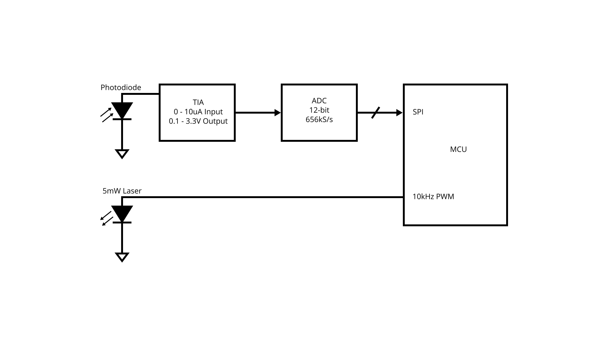
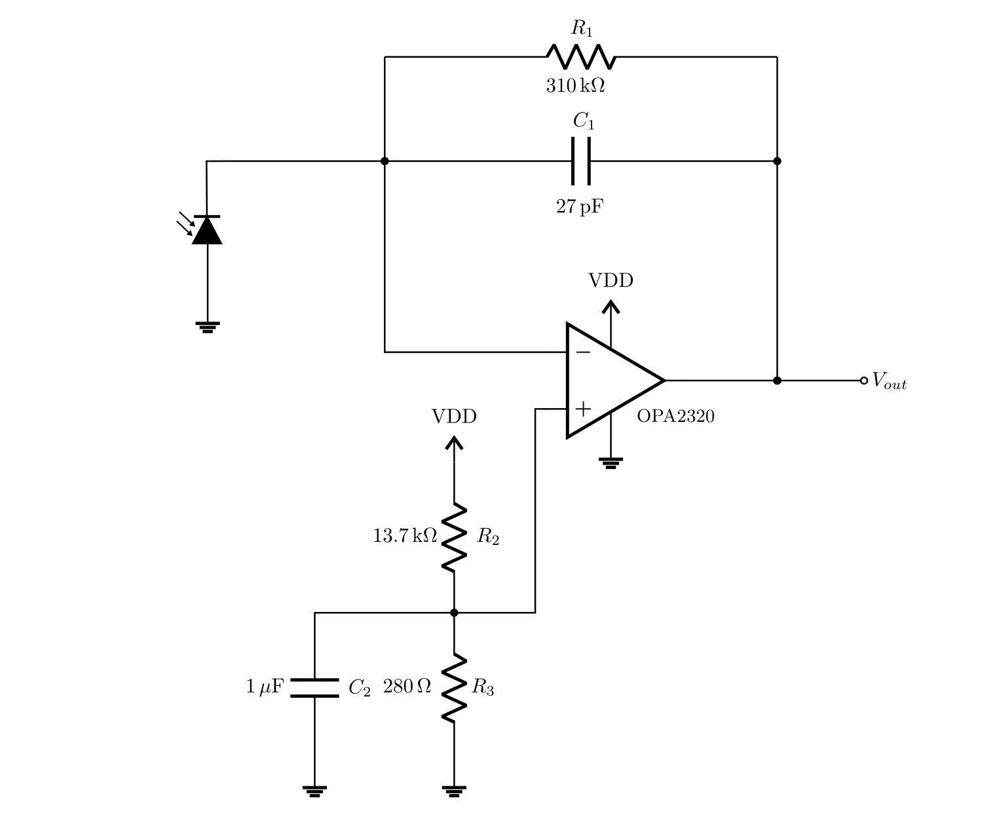
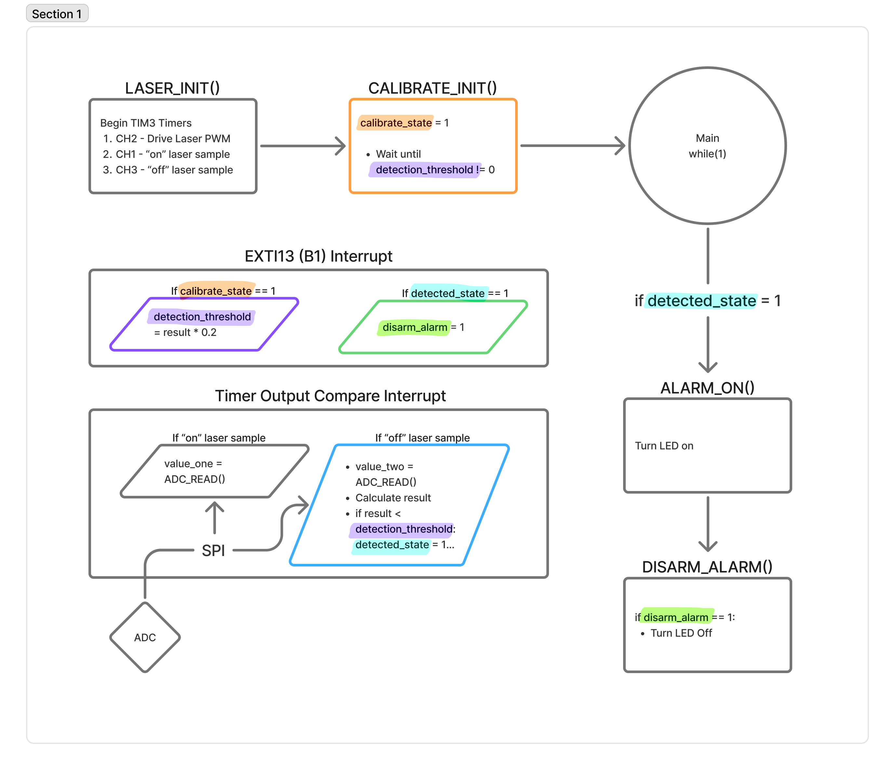
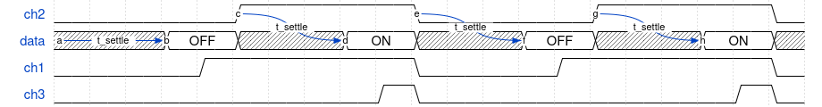

# don't touch the laser

**Laurel Cox and Daniel Theunissen**

Embedded Software fall 2026 midterm project

## Project Overview

This is the firmware for a laser beam-break detector.

### [Video Demo Here!](https://youtube.com/shorts/H3ggRmSxl1E?feature=share)

## Hardware Architecture

The basic concept here is similar to that of an IR receiver. A red 5mW laser diode is aimed at a piece of retroreflective tape on the opposite wall. The light is reflected and sensed by a photodiode, which goes into a transimpedance amplifier (TIA). This allows any interference in the reflection to be sensed as a change in voltage. Then, we use a 12-bit ADC with a SPI interface to sample the value. However, this signal is really small (on the order of 50-100nA or 2-4 LSBs), so to sense it, we modulate the LED signal. Then, in firmware, we apply lock-in detection to demodulate the TIA output and determine if the LED signal is present or not.

### TIA Design

## Firmware Architecture

Our firmware has quite a few different components (i.e. calibration and alarm handling), but at the heart of its capabilities, its enabled by the sensor readings and detection method.

### Reading Values

Our laser signal is read in by the ADC over SPI. We use one timer with 3 channels to drive our laser PWM and then sample on the high and low of the PWM period. We capture the high period sample in $sample_{on}$ and the low sample in $sample_{off}$ during their output capture interrupts. We observed on an oscilloscope that there is some electrical coupling on the switching edge of the PWM signal. After around a settling time, $t_{settle} = 20 \mu s$, the signal is safe to sample. So timer channels 1 and 3 are configured to fire $5 \mu s$ before each switching edge to make sure that the signal has settled.

### Detection

For our detection method, we use principle of Lock-in Detection to filter out noise in our signal. To do this, we gather samples of "on" and "off" from the ADC. Once the pair of samples are taken, we do $sample_{on} - sample_{off}$ to calculate their difference. By taking the difference of $sample_{on}$ and $sample_{off}$, we're able to isolate our laser signal by essentially removing all the environmental noise using what we know about the signal when the laster is off. Then, we add the difference to an `accumulator` variable and repeat the sampling until we've reached 250 sample pairs. After the 250 samples are accumulated, we find the mean ADC `result` value. The number 250 was chosen because it's high enough to get a fairly reliable output value, but also low enough to allow us to still sample and process quickly.

Every time we calculate the result value, we check if it's below our calibrated threshold. If it is, we flag the `detected_state` variable.

### Calibration

The Calibration Phase is initiated after the laser. In this phase, the user can align the laser beam to the reflective tape. The MCU waits until B1 is pressed by the user, triggers the EXTI interrupt, which then captures the result value and sets the `detection_threshold` = `result` $* 0.75$.

### Alarm Handling

In the main while loop, `detected_state` is monitored. When flagged, it moves to the `ALARM_ON()` function which sets the GPIO pin connected to the LED high. Then, it moves to the `DISARM_ALARM()` function, where the system waits until B1 is pressed before returning to its standard detection state.

## Debugging Experience

Overall, the complexity of our system was quite manageable on the firmware end. There was some trial and error to figuring out what ratio to use for the `calibration_threshold` and the number of accumulated samples. But for coding bugs strictly, early on in development, we ran into a problem where our ADC value only read the `output value`/2. This was a strange bug, because our ADC was reading a signal and was (un)proportionally correct. After looking at our ADC datasheet some more, we found that we needed to send bits on the low edge of the `SCLK`. We fixed this by configuring the SPI setting CLK Polarity to low in CubeMX.
